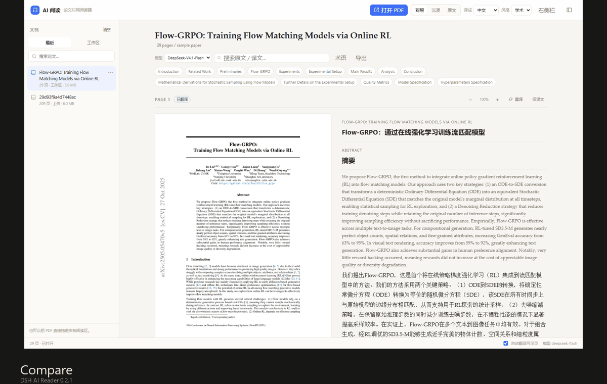
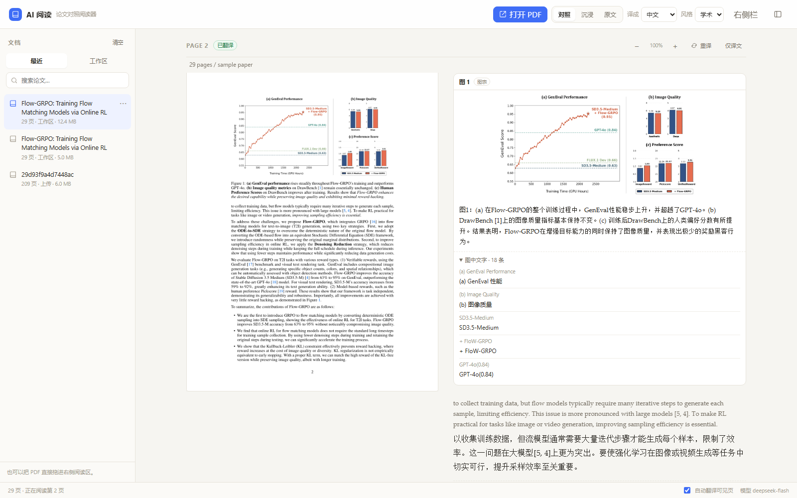
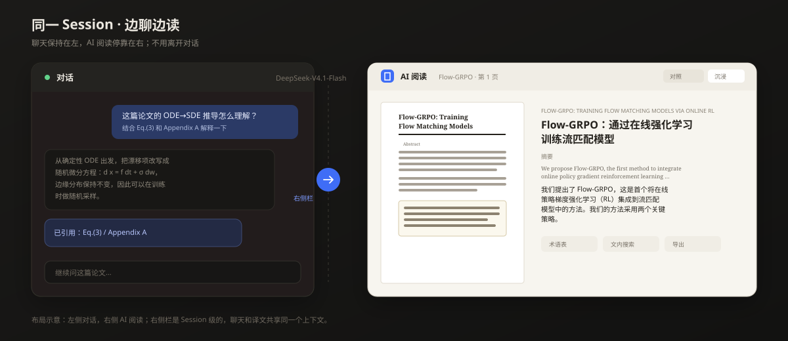
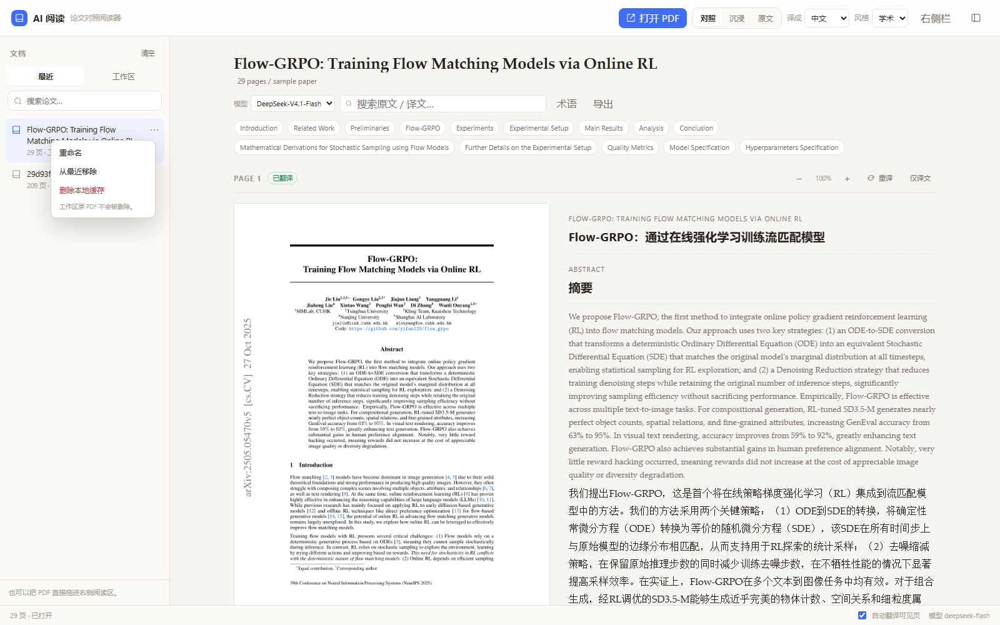
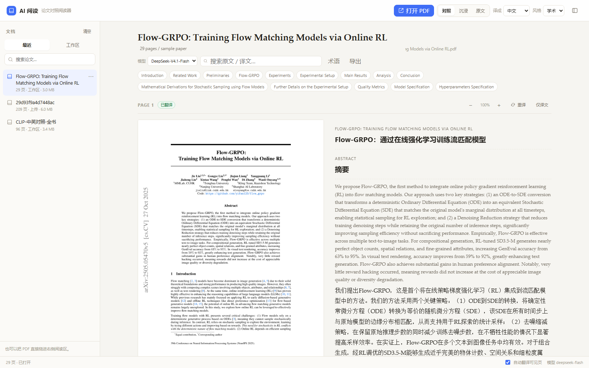
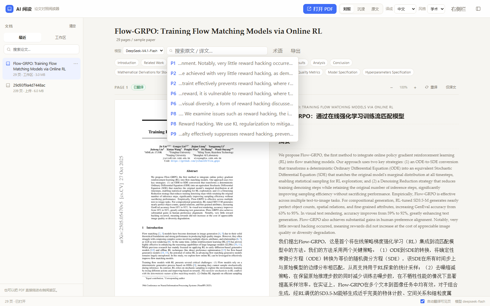
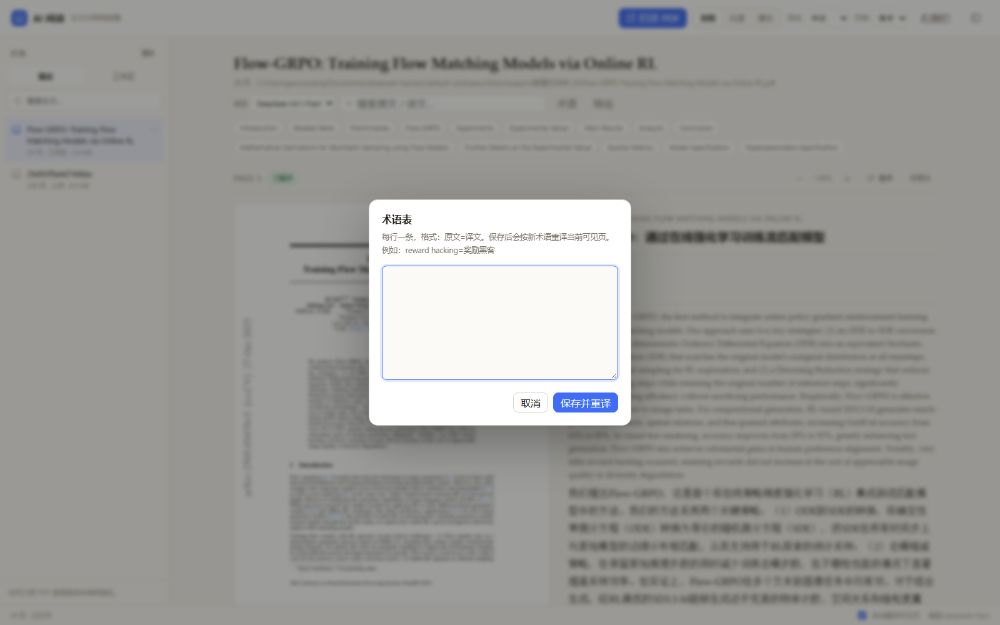
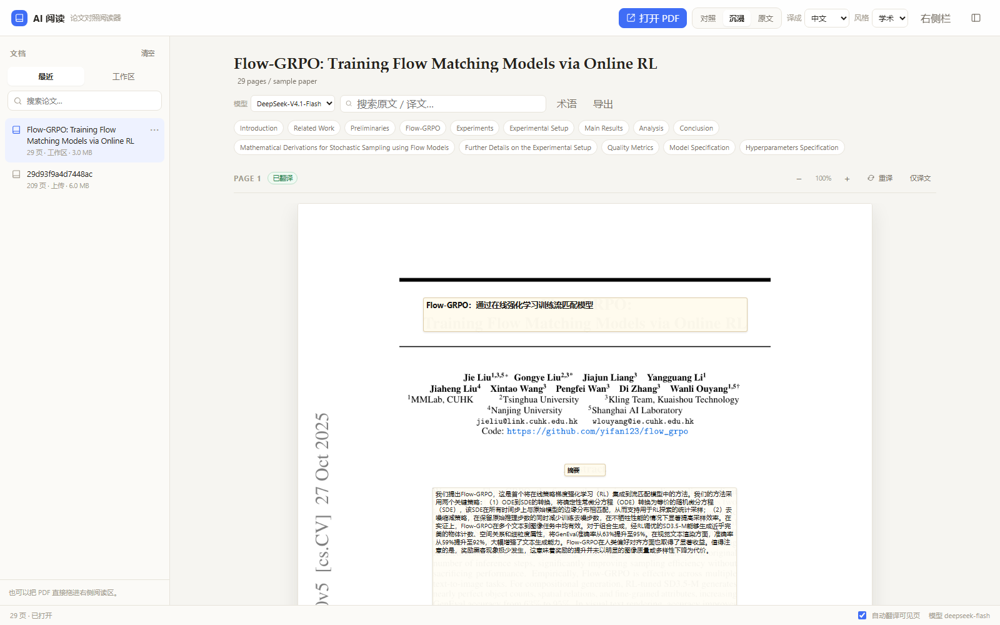
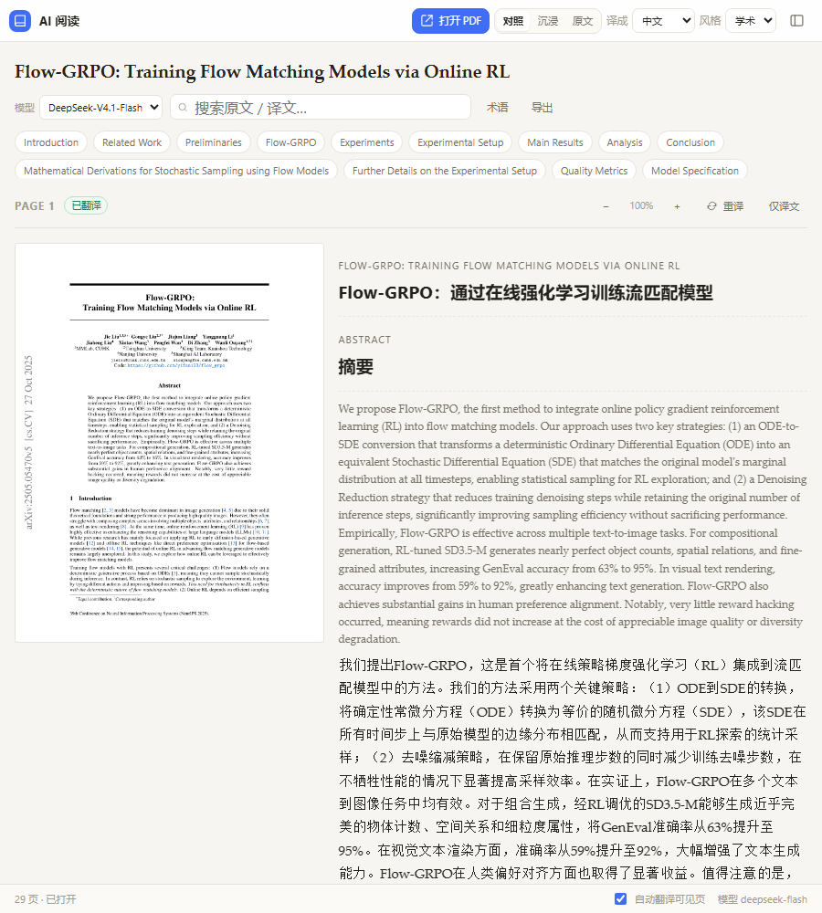

# DSH AI Reader

> 在 [DeepSeek Harness](https://github.com/deepseek-ai/deepseek-harness)（DSH）里边聊边读论文：打开 PDF，按页翻译，左侧保留原始版面，右侧逐段中英对照；也可以把译文直接覆盖在原文位置上。

**版本 0.3.1** · DSH 0.2.x · MIT



## 0.3 更新：图表回到译文栏，图中文字可查

- **图表卡片**：右侧译文栏按阅读顺序插入图/表卡片，不再只剩文字；图注跟着翻译。
- **图中文字**：对图表截图做 OCR，生成可折叠的「图中文字」双语列表；不覆盖、不改写原图。
- **点击放大**：图表卡片可点击放大，看坐标轴、图例和细节。
- **可关闭**：工具栏「图表」按钮可以隐藏/显示所有图表卡片，避免对照模式太拥挤。
- **可选 OCR**：没有安装 OCR 依赖时，图表和图注仍然显示，只是「图中文字」列表提示安装。
- **整体缩放**：`Ctrl + 滚轮` 或页头 `− / +` 缩放整个阅读区（原文、译文、图注、图表一起）；`Ctrl + 0` 重置，比例会记住。



## 0.2 更新：从“翻译 PDF”到“边聊边读”

这不是一个只会生成译文 PDF 的工具。0.2 把阅读器接进了 DSH 对话：

- **边聊边读**：输入框附加 PDF → 点「AI 阅读」→ 阅读器停靠右侧，聊天压缩到左侧；全屏阅读器也可以一键「右侧栏」。
- **最近文档管理**：最近列表支持重命名、从最近移除、删除本地缓存、清空最近；上传标题使用原文件名。
- **引用到对话**：每段右侧「引用」把原文/译文插入当前输入框，不自动发送。
- **翻译工作台**：模型选择、术语表、文内搜索、页面缩放、段落高亮、Markdown 导出。
- **同一个 Session**：没有另起 agent，也没有第二个模型会话；聊天和译文共享当前 DSH 会话与模型服务。

## 边聊边读



### 方式 A：从聊天输入框打开

1. 在对话输入框附加一篇 PDF（点文件按钮或直接拖拽）。
2. 输入框工具栏出现「**AI 阅读**」，点击。
3. 阅读器在右侧栏打开，聊天自动压缩到左侧。
4. 右侧继续切换对照/沉浸、模型、术语表、搜索和导出。

> 按钮不依赖 PDF 已经解析完成；即使没有附件，也可以先打开空阅读器，再从「最近」或「工作区」选论文。

### 方式 B：从全屏阅读器停靠

1. 左侧栏打开「AI 阅读」，打开一篇论文。
2. 点右上角「**右侧栏**」。
3. 插件会先回到当前对话，再把这篇论文停靠到右侧；左侧就是聊天。

> 右侧栏是 Session 级的。如果提示 `sidebarRight: no session surface is mounted`，说明当前没有挂载的对话：先点一个聊天会话，再点「右侧栏」。

### 引用到对话

每段译文右侧有「引用」按钮。点击后会把这一段以引用块插入当前输入框，不会自动发送；编辑器不可写时退化为复制。

## 文档管理



最近列表每行右侧 `⋯`：

| 操作 | 行为 |
|---|---|
| 重命名 | 只改显示标题，不移动原文件 |
| 从最近移除 | 从列表移除，保留缓存文件 |
| 删除本地缓存 | 删除页面图、译文和上传副本 |
| 清空最近 | 清空列表并删除这些文档的缓存 |

工作区里的原 PDF **永远不会被删除**。上传的 PDF 副本会随缓存一起删除。上传标题现在优先使用原文件名；历史 hash 标题可以用「重命名」修正。

## 翻译工作台



| 功能 | 说明 |
|---|---|
| 对照 | 左侧原始页面，右侧逐段英文原文 + 中文译文 |
| 沉浸 | 译文按段落 bbox 覆盖到页面上，保留图表、公式和排版位置 |
| 原文 | 只看 PDF 页面 |
| 模型 | `deepseek-flash` / `deepseek-v4-pro` 切换，缓存按模型隔离 |
| 术语表 | 每行 `原文=译文`，保存后按术语重译，缓存按术语表哈希隔离 |
| 文内搜索 | 搜索原文/译文，跳转到对应段落 |
| 图表 | 按阅读顺序在译文栏插入图/表卡片，图注翻译 |
| 图中文字 | OCR 后提供双语列表；纯数字刻度会跳过 |
| 缩放 | 整体缩放阅读区：`Ctrl+滚轮`、页头 `−/+`、`Ctrl+0` 重置；原文/译文/图表一起缩放 |
| 导出 | 当前文档已翻译内容和图中文字导出为 Markdown |

| 文内搜索 | 术语表 |
|---|---|
|  |  |

### 图表和图中文字

阅读器会从每一页提取：

- PyMuPDF 识别到的位图区域；
- `find_tables()` 识别到的表格区域；
- 有 `Figure N` / `Table N` 图注的矢量图区域（用图注附近的图形聚类补齐）。

这些区域被裁剪成 PNG，按 bbox 的阅读顺序插到译文段落之间。图注继续走原来的翻译管线；图表内部的文字用 RapidOCR 识别，去掉纯数字刻度后，作为可折叠的「图中文字」列表展示，并逐条翻译。

> OCR 是**可选的**：
>
> ```bash
> python -m pip install -r worker/requirements-ocr.txt
> ```
>
> 不安装时，图表和图注仍然工作；「图中文字」会提示缺少 OCR 引擎。设置环境变量 `DSH_AI_READER_OCR=0` 可以完全关闭 OCR。
>
> 这是“看图 + 查图中文字”，不是把原图重绘成中文图；复杂公式、密集坐标轴和低分辨率截图仍可能有 OCR 错误。

### 沉浸翻译



### 右侧栏紧凑布局



## 环境要求

| 组件 | 版本 |
|---|---|
| DSH Desktop | 0.2.x（在 0.2.1-rc.5 上测试） |
| Python | 3.10+，`python` 需要在 PATH 中 |
| PyMuPDF | 1.24–1.x（在 1.28.2 上测试） |
| RapidOCR（可选） | 1.2.x，用于「图中文字」OCR |

不需要 Node.js 构建：仓库里的 `client.js` 是可直接加载的客户端 bundle。

## 安装

### 1. 克隆仓库

```bash
git clone https://github.com/River-mathematics/dsh-ai-reader.git
cd dsh-ai-reader
```

### 2. 安装 Python 依赖

```bash
python -m pip install -r worker/requirements.txt
```

要启用「图中文字」OCR，再安装可选依赖：

```bash
python -m pip install -r worker/requirements-ocr.txt
```

### 3. 安装到 DSH profile

用本地路径安装（推荐）：

```bash
dsh plugin --profile desktop add link:<本仓库绝对路径>
```

或者直接从 GitHub 安装：

```bash
dsh plugin --profile desktop add https://github.com/River-mathematics/dsh-ai-reader
```

安装后重启 DSH，或在「插件」页启用 `dsh-ai-reader`。如果只安装了依赖但没有进入 bundle 层，把 `dsh-ai-reader` 加入 profile 的 `dsh.profile.bundles`：

```json
{
  "dsh": {
    "profile": {
      "bundles": ["...", "dsh-ai-reader"]
    }
  }
}
```

也可以手动在 `~/.dsh/profiles/desktop/cordis.patch.yml` 增加：

```yaml
- insert:
    - id: ai-reader
      name: dsh-ai-reader
```

> 注意：走 bundle 层时不要再保留同 id 的 insert 行，否则加载器会因为重复 id 启动失败。

### 4. 验证

刷新 DSH 页面，左侧栏出现「AI 阅读」。打开任意文本型 PDF，第 1 页会自动开始翻译。

> 如果刷新后没有「AI 阅读」：先确认「插件」页里 `dsh-ai-reader` 是启用状态，然后重启一次 DSH。0.2.1 修复了可选右侧栏服务不可用时入口被整体回滚的问题。

## 使用

### 全屏阅读

1. 点击左侧栏「AI 阅读」。
2. 「打开 PDF」选择文件，或从工作区列表选择，也可以直接拖拽 PDF 到阅读区。
3. 默认自动翻译当前页；右上角切换「对照 / 沉浸 / 原文」、目标语言和翻译风格。
4. 每页有「重译」和「− 100% +」缩放；点击页面图可放大查看公式和图表。
5. 关闭再打开同一篇论文会命中段落缓存，基本秒开。

## 工作原理

```text
client.js（DSH Web GUI）
  ├─ 左侧栏入口 + main 全屏面板
  ├─ 右侧栏 tab（sidebarRightTabs / sidebar.right.pane.tab）
  ├─ 输入框附件按钮（conversation.input.right）
  ├─ PDF 页面图 + 段落 bbox 覆盖
  └─ /api/ai-reader/*（浏览器 webServer + 桌面 shell fetch route）
        │
        ├─ host.js：打开/上传/最近管理/页面图/翻译
        │    ├─ worker/main.py（PyMuPDF）：段落 / 图表提取 + 页面 PNG + OCR
        │    └─ ctx.llm.stream()：调用 DSH 当前账号可用的模型
        │
        └─ ~/.dsh/cache/ai-reader/：文档、页面图、图表裁剪、翻译缓存
```

- 段落按 PyMuPDF 的 block/column 信息提取，过滤页眉页脚、图表标签和公式碎片。
- 图表区域另外保存为 `figures/pNNNN-fN.png`；OCR 文本按行保存，纯数字刻度跳过。
- 翻译按批（≤8 段/批）并发请求，返回后按 block id 合并；缓存键包含模型和术语表哈希。
- 页面图由 PyMuPDF 按 2x 渲染，滚动到附近才加载。
- 右侧栏 tab 使用 DSH 原生 `keepMounted`，切换 tab 时保留文档和译文状态。
- 没有新增 agent：翻译和聊天都走当前 DSH 会话的模型服务。

## 目录结构

```text
index.js                宿主入口（薄加载层）
host.js                 HTTP 路由与翻译编排
client.js               DSH 客户端插件 bundle
worker/main.py          PyMuPDF 提取/渲染 worker
worker/requirements.txt Python 依赖
worker/requirements-ocr.txt 可选 OCR 依赖
cordis.patch.yml        DSH bundle patch
docs/                   README 截图
```

## 缓存与隐私

- 文档、页面图和译文缓存位于 `~/.dsh/cache/ai-reader/`，删除该目录即可清空。
- 插件本身不保存 API Key；翻译使用 DSH 的登录态和模型服务。
- 路由只注册在本机 DSH 进程内（`webServer` / 桌面 shell carrier），不会额外起公网端口。
- 公开截图中的本地文件路径已做脱敏处理。

## 已知限制

- **仅文本型 PDF**：扫描版没有文本层，暂不支持整页 OCR；图表 OCR 只针对已检测到的图表区域。
- **公式**：复杂公式可能被拆成多个文本块；这些块会跳过翻译，但原文仍显示在页面图上。
- **表格**：以表格截图 + 图注为准，不逐单元格重排；OCR 列表也不保留表格行列结构。
- **图中文字 OCR**：best-effort；纯数字刻度会被跳过，斜体、公式、密集坐标轴和低分辨率截图可能识别错误。
- **图表检测**：PDF 里的图形没有统一语义，极少数纯矢量图或跨栏组合图可能漏检或合并过大。
- **延迟**：首次打开一页通常需要几秒（取决于模型）；OCR 会额外增加首次提取时间，命中缓存后很快。
- **翻译质量**：取决于 DSH 当前账号可用的模型；可以在阅读器里切换 `deepseek-flash` / `deepseek-v4-pro`。
- **右侧栏是 Session 级的**：切换对话 Session 时阅读器 tab 不会跟随；打开同一 Session 会保留。需要跨 Session 时可使用左侧栏的全屏阅读。
- **导出范围**：Markdown 导出包含当前文档所有已翻译段落、图注和 OCR 文本；未翻译段落只保留原文。暂不支持导出 PDF 或把图片嵌入 Markdown。
- **引用到对话**：插入当前输入框光标位置；如果编辑器不可写，会退化为复制到剪贴板。

> PyMuPDF 由用户通过 `worker/requirements.txt` 单独安装，遵循其 AGPL / 商业许可；RapidOCR 通过 `worker/requirements-ocr.txt` 可选安装。本仓库不打包这两个依赖。

## 开发

```bash
# 语法检查
node --check index.js
node --check host.js
node --check client.js

# Python worker 编译检查
python -m py_compile worker/main.py
```

客户端是手写的 CJS 风格 bundle，外层包装为 `window.__ModuleLoader__.load(...)`；修改 `client.js` 后刷新 DSH 页面即可加载新 bundle。宿主侧 `index.js` 通过带时间戳的动态 import 加载 `host.js`，便于在开发时通过插件重载更新路由。

## 更新日志

### 0.3.1

- 缩放改为整体缩放阅读区：原文页面、译文、图注和图表卡片一起缩放。
- 支持 `Ctrl + 滚轮`、页头 `−/+`、`Ctrl+0` 重置，比例按主阅读器/右侧栏分别记忆。
- 缩放时尽量保持当前阅读位置，避免跳回页首。

### 0.3.0

- 新增图表/表格卡片：位图、表格和带图注的矢量图按阅读顺序插入译文栏。
- 新增图注翻译和「图中文字」OCR 双语列表，纯数字刻度自动跳过。
- 新增「图表」显示/隐藏开关、图表点击放大、OCR 可选依赖。
- 翻译时跳过图表区域内的重复文本块，避免右侧出现两遍标签。
- Markdown 导出包含图注和 OCR 文本。

### 0.2.1

- 修复可选右侧栏服务不可用时侧边栏入口被整体回滚的问题。
- 修复全屏阅读器停靠时先打开右侧栏、导致 `no session surface is mounted` 的问题。
- 输入框「AI 阅读」按钮改为常驻，不依赖是否已经附加 PDF。

### 0.2.0

- 新增最近文档重命名/删除/清空、缓存大小与来源、上传标题修复。
- 新增右侧栏阅读器、输入框附件按钮、compact 布局、引用到对话。
- 新增模型选择、术语表、文内搜索、页面缩放、段落高亮、Markdown 导出。
- 翻译缓存按模型和术语表哈希隔离。

### 0.1.0

- 全屏阅读器、按页翻译、对照/沉浸/原文模式、页面级缓存。

## Roadmap

- [x] 右侧栏 / 聊天内嵌模式。
- [x] 段落「引用到对话」。
- [x] 术语表 / 锁定译名（基础版）。
- [x] 模型选择器（`deepseek-flash` / `deepseek-v4-pro`）。
- [x] 文内搜索、页面缩放、段落高亮、Markdown 导出。
- [x] 图表卡片、图注翻译、图中文字 OCR 列表。
- [ ] 术语表 `locked` 语法与导入文件。
- [ ] 导出并排 PDF。
- [ ] 表格单元格结构化翻译。
- [ ] 翻译后图片叠加/重绘（实验性）。
- [ ] 扫描版 OCR / 公式 LaTeX。

## License

[MIT](LICENSE)
